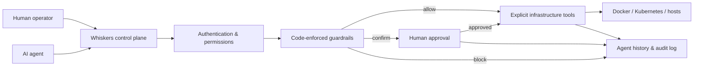

# Governance model

How Whiskers decides what a human or an AI agent may do, and what it records. Moved out of the top-level README;
the canonical positioning is in [product/POSITIONING.md](product/POSITIONING.md).

> *"In the dark, predators don't rely on sight. They rely on their whiskers to sense the slightest vibration in the
> air before striking — or stepping into a trap. **Whiskers** is the tactile sensory layer and zero-trust execution
> mesh between hallucinating AI agents and your production infrastructure."*

## Compared with a typical Docker/Kubernetes MCP server

The common pattern for a Docker or Kubernetes MCP server is to run it over `stdio` next to the agent and give it the
raw `/var/run/docker.sock` or a kubeconfig. Whatever the model hallucinates, the socket executes.

| | Typical Docker/K8s MCP server | Whiskers control plane |
|---|---|---|
| **Access** | Raw `docker.sock` or kubeconfig in the agent's process | The agent never touches the socket or the kubeconfig (encrypted in the vault) — it calls scoped tools; Kubernetes workloads are operated from the governed UI today, MCP pod tools are on the roadmap |
| **Reach** | `stdio`, one host | Agent ↔ Whiskers over Streamable HTTP; Whiskers ↔ many hosts over mesh + mTLS — no standing SSH key once a host is onboarded |
| **Permissions** | Everything the socket allows | Per key: Read, Write or Admin scope, optionally narrowed to an explicit tool list — checked on every call |
| **Risky actions** | Executed as requested | Guardrails (core, always on) allow, deny or pause for human approval; blast-radius and update-risk assessment tools available before an update (`get_blast_radius`, `assess_update_risk`; the `plan_safe_update` prompt chains them) |
| **Afterwards** | Usually no record | Hash-chained audit trail (checkpoints signed, and the trail tamper-evident, when `VAULT_KEY` is set) plus Agent History |

**Zero-trust here means:** no caller is trusted by default — every call is authenticated (API key or signed-in user),
scope-checked and guardrail-evaluated in code, and every onboarded Docker host is reached over a private WireGuard
mesh, with the Docker and host-control planes on mTLS (client certificate, CN-pinned). The opt-in `Auth:Disabled` LAN
mode switches authentication off.

- **Limit what an operator or agent can do.** API keys, roles and explicit tool access define the available capability
  set — no arbitrary shell below Admin scope; the Admin-only `execute_command` is guardrail-checked and audited.
- **Require approval before impact.** Code-enforced guardrails allow, block, or pause sensitive operations for human
  confirmation.
- **Know exactly what happened.** Agent History and the Audit Log record actor, decision, target, parameters (secrets
  redacted) and result.

## Flow

## The hero workflow

**Observe → Propose → Check policy → Request approval → Execute → Verify → Audit**:

1. A container / workload is **unhealthy**.
2. An agent analyses status and logs using a **read**-scoped key — no write access needed.
3. The agent **proposes a restart**.
4. The active guardrail rates the restart tool as **Confirm**, so nothing runs yet.
5. Whiskers raises an **approval request**: actor, tool, target server, target workload, redacted parameters,
   rationale and expiry.
6. A human **approves** it.
7. Whiskers executes **only** the approved action, with the approved parameters.
8. Whiskers **verifies** the workload afterwards.
9. **Agent History** and the **Audit Log** show the full chain, and the UI deep-links between result, approval and
   history.

This is the reference workflow for AI-operations onboarding and the acceptance test for governance. The scripted
walkthrough is in [product/demo-script.md](product/demo-script.md).

## How the policy layer applies

The guardrails are a **deterministic policy-enforcement layer** (Read / Write / Admin scopes, action classification
and human-in-the-loop approvals), evaluated in code at the tool boundary — never in a prompt, so no model output can
talk its way past it.

| Caller | Scope check (Read / Write / Admin, tool allow-list) | Guardrail engine (Allow / Confirm / Block) | Recorded in |
|---|---|---|---|
| External MCP client, direct tool call | ✅ by API key | ✅ every call; `Confirm` raises an approval, and the **identical** call runs **once** after a human approved it (approve-then-retry, valid 10 min) | Agent History |
| Signed-in web user calling `/mcp` | ✅ by role (Viewer → Read, Operator → Write, Admin → Admin) | ✅ same as above | Agent History |
| In-process agent (triggered from the UI **or** via MCP `instruct_agent`) | ✅ capped at the triggering user's / key's scope | ✅ every call; `Confirm` pauses the run until a human approves the exact action + parameters | Agent History |

Approvals are resolved on the *Approvals* page; approving requires at least the level the action needs. The guardrail
engine and approvals are core: they also govern direct MCP calls when the agent module is switched off.
