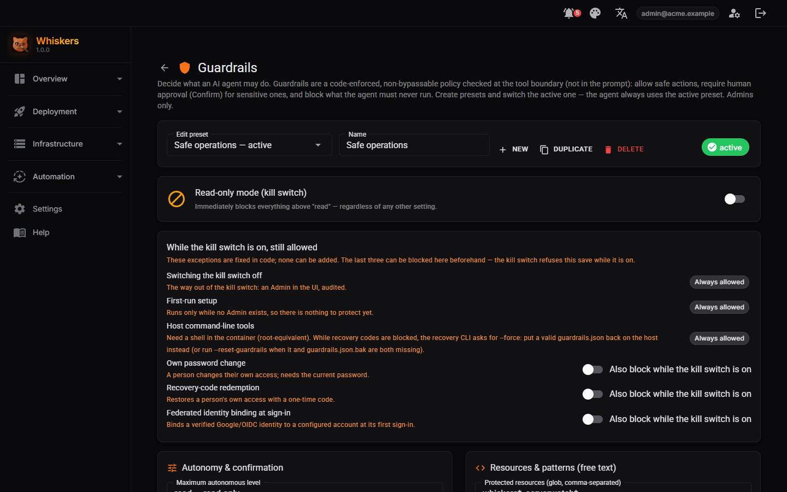
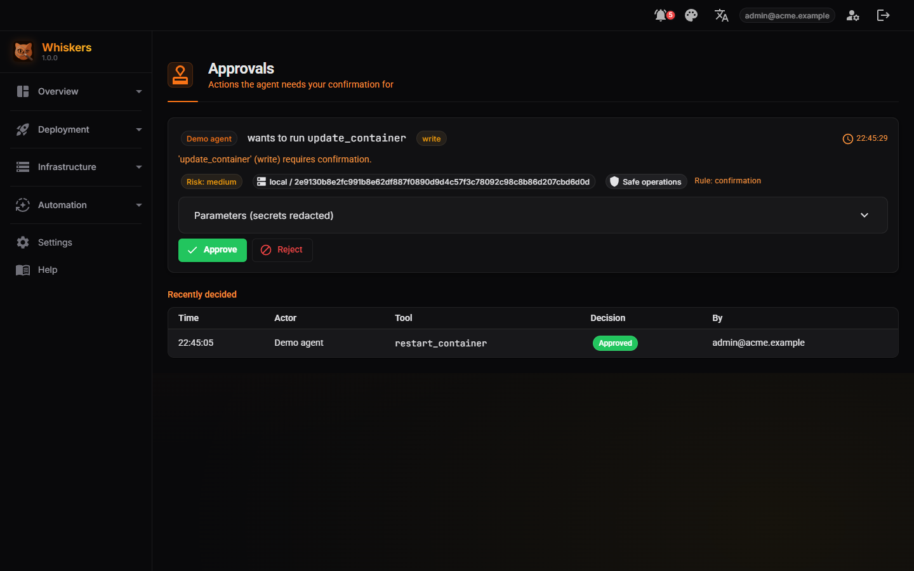
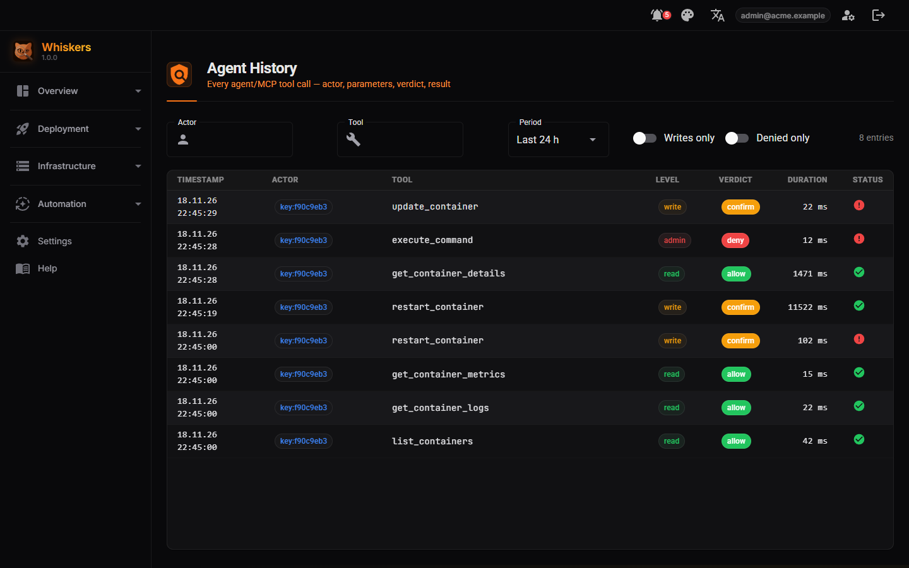
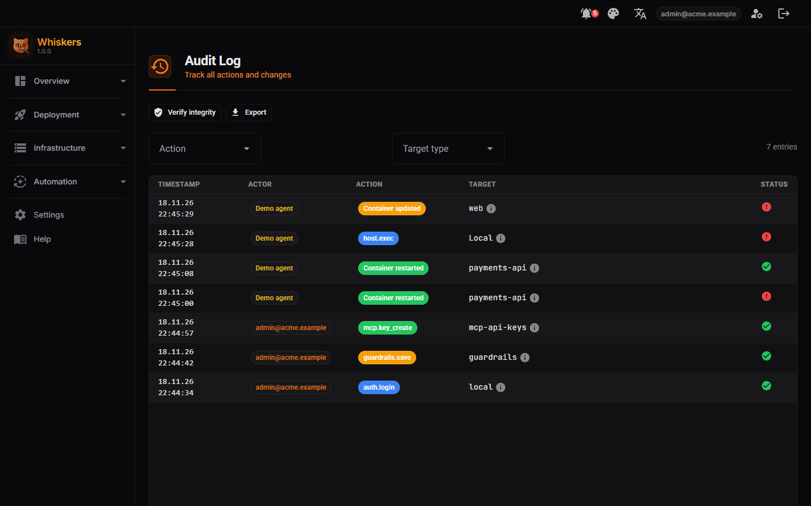
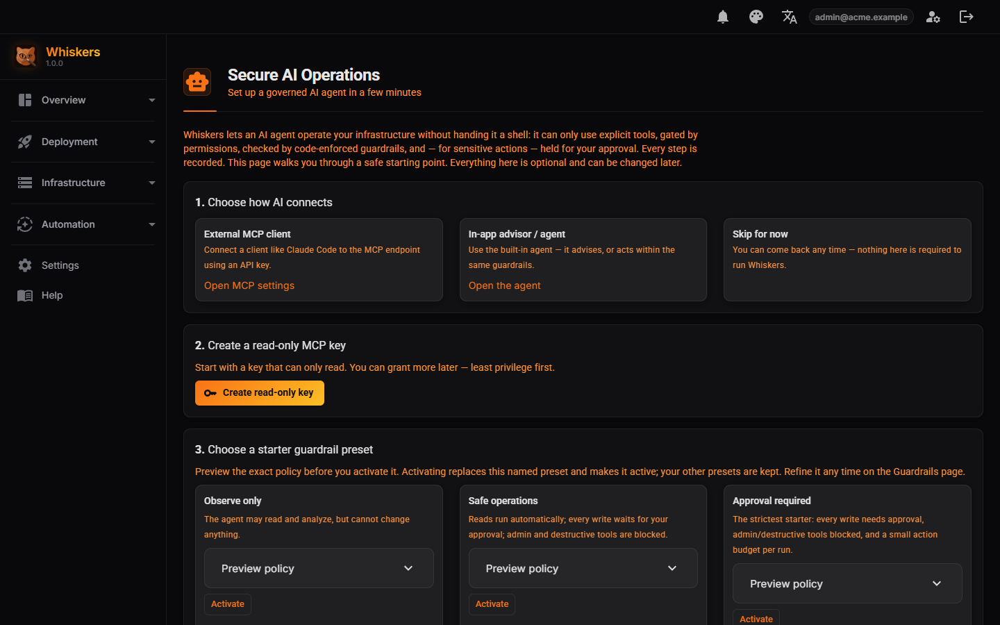
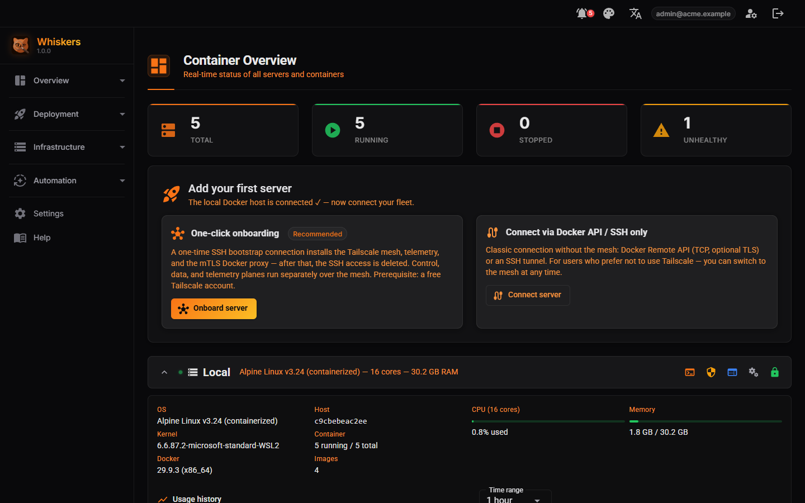
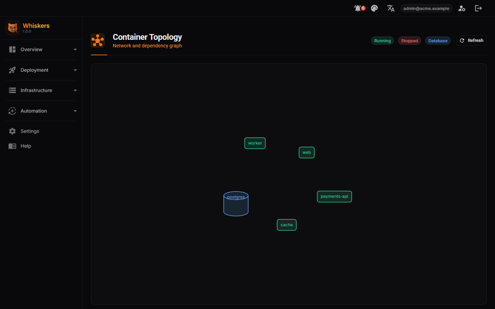

# Screenshots

Captured against an isolated demo Docker daemon; the history comes from real MCP calls of a demo agent. How each image is reproduced: [product/screenshots.md](../product/screenshots.md);
the scripted walkthrough: [product/demo-script.md](../product/demo-script.md). The in-app handbook (*Help*) has screenshots
for every area.

**Guardrails.** The policy checked at the tool boundary: a read-only kill switch, the highest level allowed without
confirmation, protected resources, and forbidden argument patterns.

**Approvals.** A write the active preset holds back: the agent waits until a person approves or rejects it. Risk,
target and the (redacted) parameters are shown before the decision.

**Agent History.** Every agent/MCP tool call, with actor, privilege level (read / write / admin), the guardrail verdict
(Allow / Confirm / Deny), duration and outcome.

**Audit Log.** The approval and execution trail: who approved what, which action a guardrail blocked, and the
resulting change.

**AI Operations onboarding.** Connect a client, create a read-only key, and activate a starter guardrail preset
(Observe only / Safe operations / Approval required).

**Dashboard.** Status across Docker hosts and Kubernetes workloads, with a summary per host.

**Topology.** The containers of a host as a graph.

