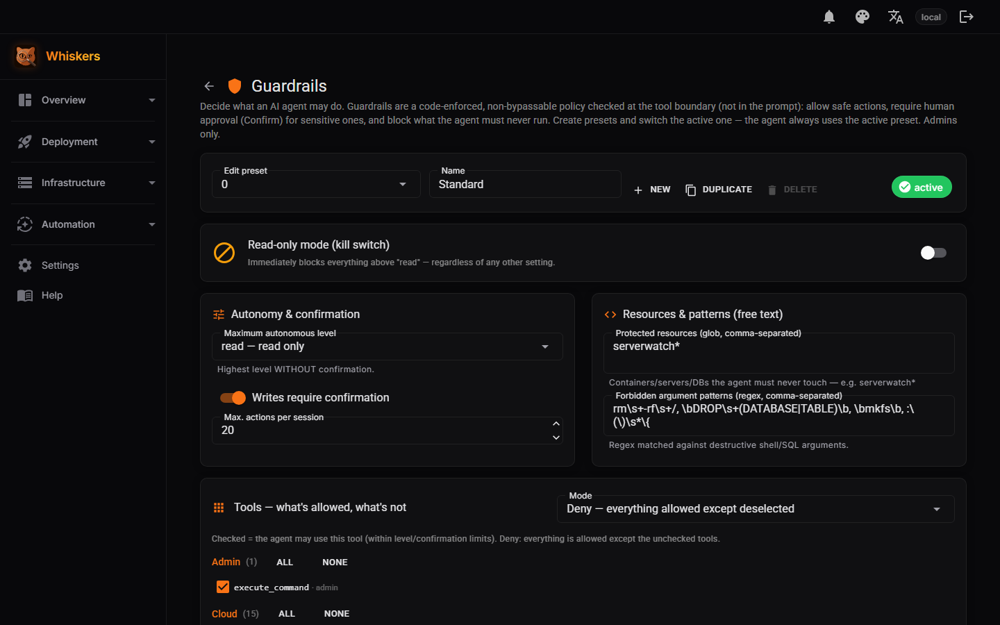
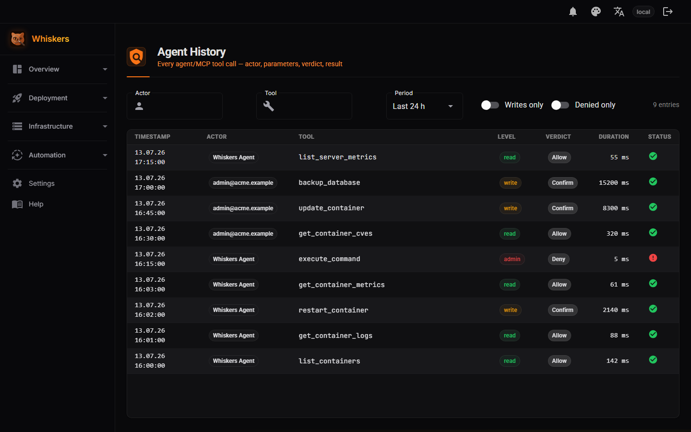
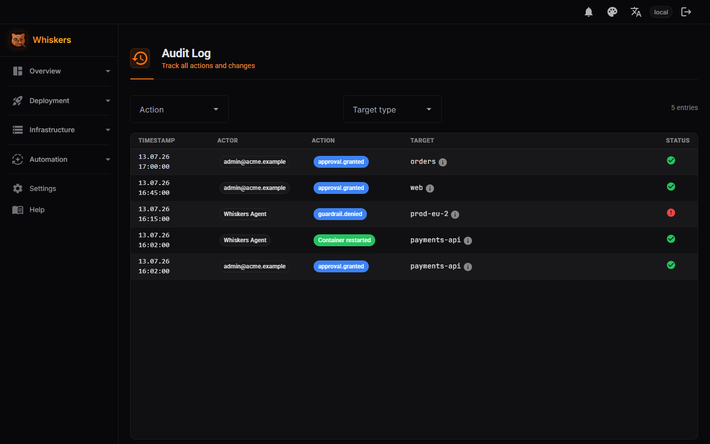
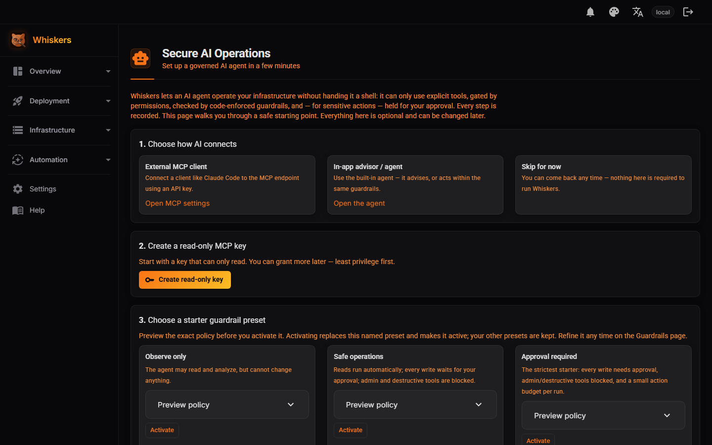
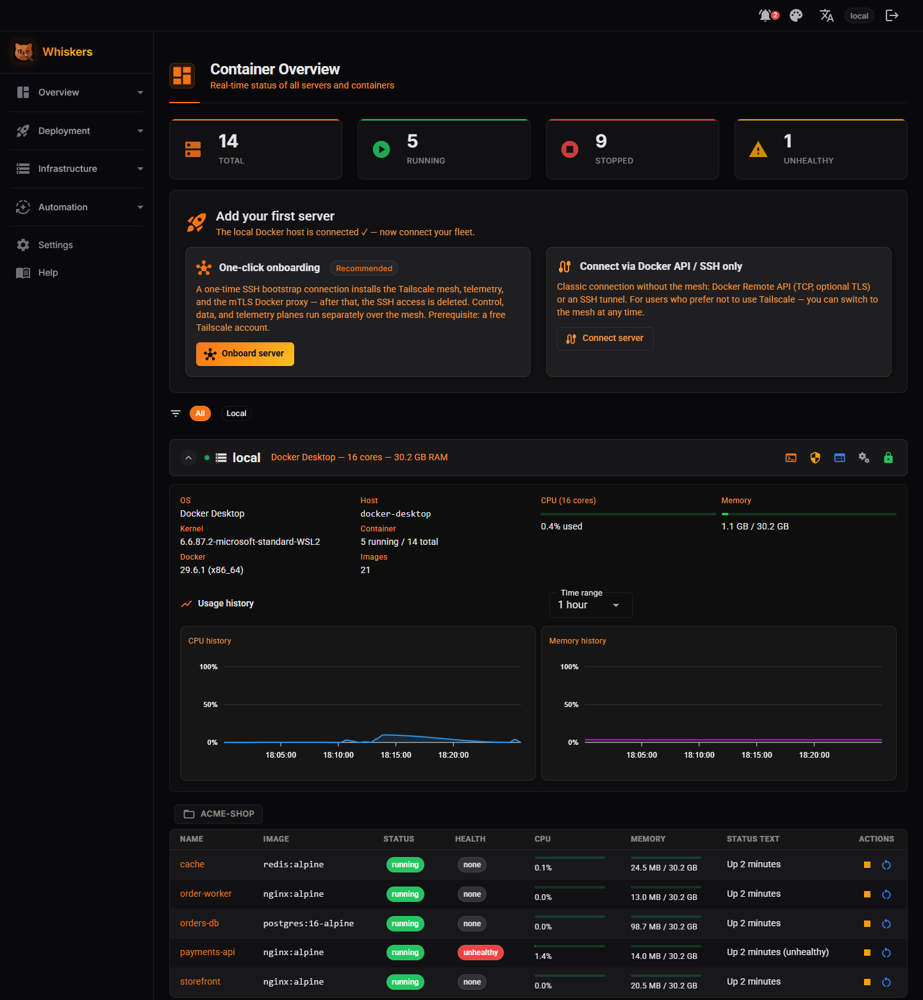

# Screenshots

Captured against an anonymized demo dataset. How each image is reproduced: [product/screenshots.md](product/screenshots.md);
the scripted walkthrough: [product/demo-script.md](product/demo-script.md). A live walkthrough of the hero workflow is
on [whiskers.app.lupusmalus.dev](https://whiskers.app.lupusmalus.dev), and the in-app handbook (*Help*) has screenshots
for every area.

**Guardrails.** The policy checked at the tool boundary: a read-only kill switch, the highest level allowed without
confirmation, protected resources, and forbidden argument patterns.

**Agent History.** Every agent/MCP tool call, with actor, privilege level (read / write / admin), the guardrail verdict
(Allow / Confirm / Deny), duration and outcome.

**Audit Log.** The approval and execution trail: who approved what, which action a guardrail blocked, and the
resulting change.

**AI Operations onboarding.** Connect a client, create a read-only key, and activate a starter guardrail preset
(Observe only / Safe operations / Approval required).

**Dashboard.** Status across Docker hosts and Kubernetes workloads, with live host metrics.

